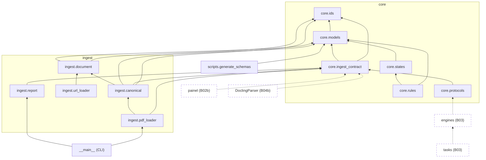

# Arquitetura

Atualizado em 2026-11-11 (após o B04 antecipado). Este documento descreve o que
existe no código; o planejado aparece tracejado nos diagramas e marcado como
planejado. O único diagrama de fluxo do projeto está em
[docs/mapa/fluxo.md](mapa/fluxo.md).

## Camadas

| Camada | Pasta | Papel | Regra |
|---|---|---|---|
| Contratos | `contracts/` | JSON Schema, prompts, lentes e casos — independentes de linguagem | Gerados de `core/models.py`; nunca editados à mão |
| Domínio | `research/map_relations/core/` | Modelos Pydantic, IDs, transições de estado, regras e Protocols | Sem dependência de fornecedor; síncrono e puro (ADR 005) |
| Ingestão | `research/map_relations/ingest/` | Parsers → IngestResult (texto canônico NFC) | Todo parser implementa `DocumentParser` |
| CLI | `research/map_relations/__main__.py` | `python -m map_relations ingest <pdf>` | Só orquestra; sem lógica de domínio |
| Scripts | `scripts/` | Geração/verificação de schemas | Rodam só em Docker |
| Testes | `tests/` | pytest, tudo em Docker | Não importam fornecedores diretamente |

Pastas previstas na estrutura e ainda vazias (planejado): `engines/`, `tasks/`,
`segment/`, `pipeline/`, `verify/`, `resolve/`, `analysis/`, `compose/` e o
painel (B02b). `nlp/` tem NER usado só em testes até o B05.

O código vive em `research/map_relations/` mas instala como pacote
`map_relations` (hatchling; editável na imagem dev, não editável na prod) —
imports são sempre `map_relations.*`, sem PYTHONPATH
([ADR 007](adr/007-pacote-instalavel.md)).

## Contratos

### Modelo de domínio (`core/models.py`)

15 modelos Pydantic — entity, alias, mention, relationType, source, segment,
claim, participation, evidence, timeScope, lens, pass, run, changeLog, note —
com snake_case em Python e alias camelCase no JSON (`populate_by_name`).
Os JSON Schemas em `contracts/schemas/` são gerados por
`scripts/generate_schemas.py`; o CI falha se estiverem desatualizados.

Regras centrais:
- Transições de estado na tabela do [ADR 006](adr/006-transicoes-de-estado.md):
  auto move entre proposta/verificada/rejeitada; humano decide estados humanos;
  estados humanos nunca são alterados por processamento automático.
- Identidade por UUID + chaves de conteúdo para upsert
  ([ADR 003](adr/003-ids-estaveis.md)).
- `validate_claim_kinds` rejeita claims com kind incompatível com o relationType.
- Toda transição gera ChangeLog com actor e run_id/pass_id (`core/rules.py`).

### IngestResult (`core/ingest_contract.py`)

Saída única de qualquer parser: texto canônico NFC, lista de parágrafos
(id, sourceId, chapter, number, offsets), capítulos, itens removidos com motivo
e página, e QualityReport com alertas. Offsets em Unicode code points sobre o
texto NFC ([ADR 004](adr/004-offsets-nfc.md)). `locate(offset)` devolve
"cap. X, § Y" — referência legível, nunca usada para verificar provas.

### Protocols (`core/protocols.py`)

- `LlmEngine` — id, capabilities, `complete(req)` assíncrono; único ponto
  async do sistema ([ADR 005](adr/005-llm-assincrono.md)). Erros tipados:
  RateLimited, InvalidResponse, AuthError, NetworkError, Aborted.
- `SourceConnector` — lista e busca documentos de uma origem.
- `DocumentParser` — `parse(path) -> IngestResult`. Implementado por
  `PdfParser`; DoclingParser planejado (B04b).
- `ProjectStore` — persistência; sem implementação ainda (planejado).

## Componentes (nível de módulo)

O mapa de imports gerado do código real está em
[docs/mapa/imports.svg](mapa/imports.svg) (`make map`); a lista de arquivos com
papel e status está em [docs/mapa/arquivos.md](mapa/arquivos.md).

## ADRs

| ADR | Decisão |
|---|---|
| [001](adr/001-cves-imagem-base.md) | CVEs da imagem base: 2 corrigidos (zlib1g), 47 aceitos sem fix |
| [002](adr/002-docker-desktop-permissoes.md) | Docker Desktop: `user: "0:0"` no compose; appuser padrão da imagem |
| [003](adr/003-ids-estaveis.md) | UUID como identidade; chaves de conteúdo para upsert |
| [004](adr/004-offsets-nfc.md) | Offsets em code points sobre texto NFC |
| [005](adr/005-llm-assincrono.md) | Só LlmEngine.complete é async; tarefas com gather + semáforo |
| [006](adr/006-transicoes-de-estado.md) | Tabela de transições de estado; ChangeLog em toda mudança |
| [007](adr/007-pacote-instalavel.md) | map_relations instalável via hatchling; sem PYTHONPATH |
