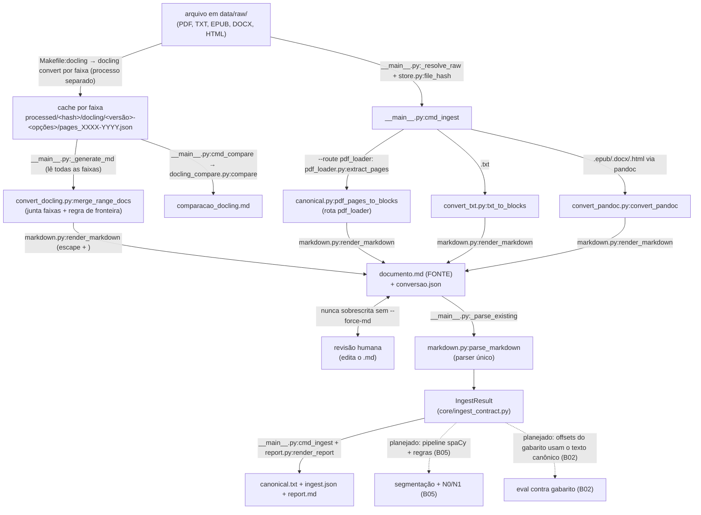

# Fluxo de dados — único diagrama de fluxo do projeto

Atualizado em 2026-11-12, após o B04c (Markdown intermediário, ADR 008).
Linhas cheias = confirmado no código (cada seta cita arquivo.py:função).
Tracejado = planejado.

Notas confirmadas no código:

- Rota padrão de PDF é o Docling via cache (`store.py:DOCLING_CACHE_KEY` =
  versão + opções); sem cache a CLI sai com código 3 e o Makefile roda o
  serviço e repete (`Makefile:ingest`).
- `documento.md` é a fonte revisada: se existe, a ingestão o reaproveita e
  nunca o regenera sem `--force-md` (`__main__.py:cmd_ingest`).
- Editar o .md muda o hash canônico e invalida offsets de gabarito/evidências
  (regra do ADR 008; teste `test_human_edit_changes_canonical_hash`).
- Marcadores `<!-- p.N -->` dão a página de cada parágrafo e não entram no
  canônico (`markdown.py:_parse_blocks`).
- `url_loader.py:load_url` segue fora do fluxo (pendência do B04).
- `make clean-processed` lista pastas órfãs; só remove com `APPLY=1`
  (`store.py:orphans` não apaga nada).
