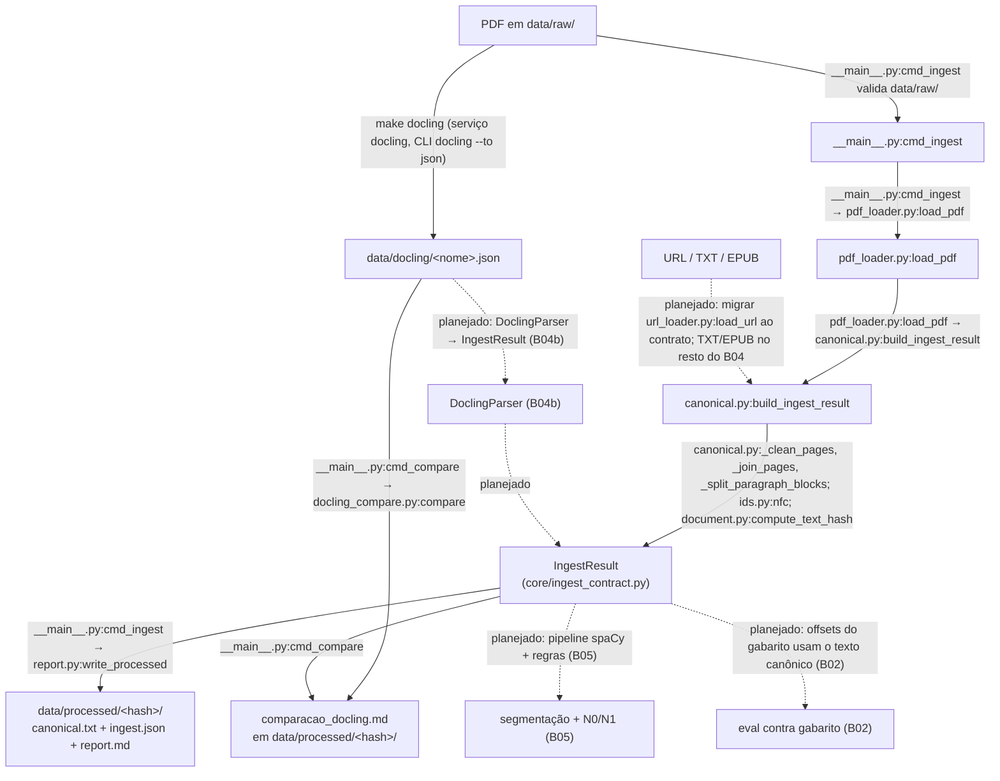

# Fluxo de dados — único diagrama de fluxo do projeto

Atualizado em 2026-11-12, após a prova do Docling (B04b-prova). Linhas cheias =
confirmado no código (cada seta cita arquivo.py:função). Tracejado = planejado.

Notas confirmadas no código:

- A validação "PDF deve estar em data/raw/" e os códigos de saída estão em
  `__main__.py:cmd_ingest` (0 sucesso, 2 entrada inválida, 1 falha de processamento).
- `canonical.py:build_ingest_result` cria o `Source` com
  `document.py:compute_text_hash` sobre o texto canônico NFC, e monta
  parágrafos e capítulos com offsets em code points (ADR 004).
- `ingest_contract.py:locate` converte offset em "cap. X, § Y"; é referência
  legível, nunca usada para verificar provas.
- `url_loader.py:load_url` existe mas ainda retorna `(Source, str)` — não está
  ligado ao fluxo (por isso tracejado).
